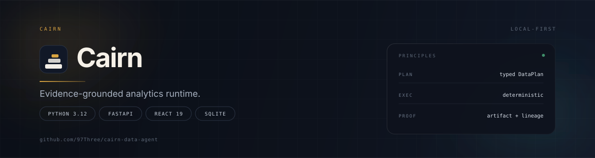
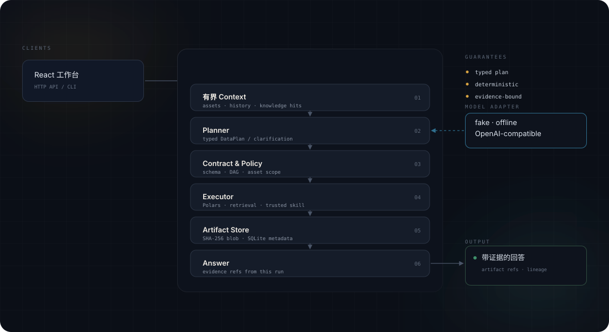

<p align="center">
  
</p>

<p align="center">
  <strong>问题进，可核验的答案出。</strong><br>
  模型只负责计划，执行、计算和证据引用全部由程序完成。
</p>

<p align="center">
  <a href="https://github.com/97Three/cairn-data-agent/actions/workflows/ci.yml"></a>
  
  
  
  
  
</p>

---

## 为什么是 Cairn

自然语言分析真正难的地方，不是"答不出来"，而是"答得看起来对"。

一句结论背后可能经过十几次筛选、聚合和连接。如果没有边界，你无法回答三个最基本的问题：这个数字从哪来、经过了哪些步骤、换一次运行会不会变。Cairn 把一次分析拆成六段可检查的链路：有界上下文、类型化计划、契约与策略、确定性执行、不可变 Artifact、带证据的回答。任何一段不成立，整个 Run 就失败，而不是给出一个无法追溯的结果。

## 教学定位

Cairn 首先是一个教学与参考实现：用一条可运行、可检查的主链路说明这类系统应该如何划分边界——模型只负责产出类型化计划，程序负责校验、执行和证据。

它刻意保持单进程、单用户、可离线运行，代码量控制在可以完整读完的范围内，方便学习、调试和二次开发。它不是生产系统：不提供多租户、鉴权、分布式队列、备份恢复等能力，具体差距见文末「安全边界」。

## 主链路

```text
问题
  → 有界 Context
  → 类型化 DataPlan / 结构化澄清
  → 契约、DAG 与资产范围校验
  → 白名单步骤确定性执行
  → SHA-256 Artifact + lineage
  → 带证据引用的回答
```

## 设计原则

| 原则 | 含义 |
| --- | --- |
| **模型不计算** | Planner 只能返回版本化的 `DataPlan` 或结构化澄清，不能直接产出数字，也拿不到 Blob 路径、数据库连接或 shell。 |
| **执行是白名单** | 筛选、派生、聚合、连接、排序、限制和文档检索由固定执行器完成，不运行模型生成的代码。 |
| **证据可追溯** | 每个中间结果都是内容寻址的 Artifact，回答只能引用当前 Run 内真实存在的证据。 |
| **离线可复现** | 没有 API Key、没有网络也能跑通完整链路，适合验证契约与回归。 |
| **领域可扩展** | 新增业务只需要增加 Scenario、Knowledge 和可选的 Skill，不必修改核心代码。 |

## 架构

<p align="center">
  
</p>

整个运行时是一个 FastAPI 进程。Planner 只通过受限适配器拿到有界上下文；契约与策略校验通过后，执行器按白名单步骤计算；结果写入内容寻址的 Artifact Store；回答只能引用本次 Run 的证据。

## 快速开始

前置：Python 3.12、[uv](https://docs.astral.sh/uv/)；运行 Web 还需要 Node.js 24 与 npm。

```bash
uv sync
npm ci --prefix web
./scripts/demo.sh
```

`demo.sh` 强制使用离线模式，在临时目录中扫描所有 Scenario 的 `evals.yaml`，使用 `examples/` 中的合成数据跑完整链路，并断言状态、Artifact 类型和证据引用。不需要 API Key，也不会在当前目录留下运行数据。

启动完整工作台：

```bash
./scripts/dev-up
```

- 工作台：<http://127.0.0.1:5173>
- API：<http://127.0.0.1:8000>
- 交互式文档：<http://127.0.0.1:8000/docs>

也可以直接启动服务：

```bash
uv run cairn-data-agent
```

## 接入真实模型

适配器使用 `POST /chat/completions`。配置通过进程环境变量注入，不要写进仓库：

```bash
export CAIRN_MODEL_MODE=openai-compatible
export CAIRN_MODEL_BASE_URL=https://your-model-endpoint.example/v1
export CAIRN_MODEL_ID=your-model-id
export CAIRN_MODEL_API_KEY=your-api-key
./scripts/dev-up
```

端点必须返回 `choices[0].message.content`，内容为符合当前 Pydantic 契约的 `DataPlan` 或 `Clarification`。无论使用哪种模型，计划都要经过相同的类型、DAG、资产范围与白名单校验。

Planner 只收到 Scenario 说明、当前问题、同一 Conversation 的有界历史、相关 Knowledge 命中和所选资产的受限 profile；Answerer 只收到问题、回答口径和当前 Run 的有界 Artifact 元数据与预览，不接触原始 Blob。完整配置见 [.env.example](.env.example)。

## 一次分析的六个阶段

| 阶段 | 做什么 | 保证 |
| --- | --- | --- |
| **上下文** | 上传 CSV / 单表 XLSX / Markdown，显式绑定 `assetIds`，生成有界快照 | 原始内容不进模型上下文，计划无法引用未选择资产 |
| **规划** | 模型读取 Scenario、历史、Knowledge 命中与资产摘要 | 只返回类型化 `DataPlan` 或结构化澄清 |
| **校验** | 检查字段、Step ID、输入引用、DAG、资产范围、步骤数量 | 非法计划不执行 |
| **执行** | Polars、文档检索或受信 Skill 按顺序执行白名单步骤 | 确定性、有行数与字节上限 |
| **持久化** | 每一步写入内容寻址的 Artifact 与 lineage | 可追溯、不可变 |
| **回答** | 只根据当前 Run 的 Artifact 组织正文与引用 | 证据不足时明确说明，不编造 |

## 扩展新领域

通常只需要新增一个扩展包，不需要修改 `src/` 或 `web/`：

```text
scenarios/my-scenario/
├── scenario.yaml
├── knowledge/
│   └── terms.md
├── examples.yaml
└── evals.yaml
```

1. 复制一个结构相近的 Scenario；
2. 目录名与 `metadata.name` 保持一致，设置版本和支持的资产类型；
3. 把术语、指标定义和回答规则写进 `knowledge/*.md`；
4. 在 `examples.yaml` 中提供离线问题匹配和合法的通用 `DataPlan`；
5. 在 `evals.yaml` 中引用合成 fixture 并声明预期结果；
6. 运行 `./scripts/check.sh`，确认静态检查、单元测试、契约测试、安装版 wheel Demo 与 Web 质量门全部通过。

可参考 [travel-budget](scenarios/travel-budget/scenario.yaml) 的配置、示例计划和评测文件。如果需求只是领域说明，优先写 Knowledge；只有独立的只读或纯计算能力才声明为 Skill。

## 项目结构

```text
src/cairn_data_agent/   Python 核心、API 与模型适配
contracts/              版本化 JSON Schema
web/                    React + TypeScript 工作台
scenarios/              领域扩展包、知识、示例计划与评测
skills/                 受控 Skill manifest 与 schema 示例
examples/               合成数据
tests/                  契约、策略、执行与主链路测试
scripts/                启动、离线 Demo、wheel smoke、统一检查与敏感信息检查
```

## 开发与检查

```bash
./scripts/check.sh
```

统一检查会运行 Ruff、mypy strict、pytest 与覆盖率、敏感文件与凭证扫描、sdist/wheel 内容清单与离线安装验证，以及 Web 的 TypeScript、Prettier、Vitest 和生产构建。

也可以分别执行：

```bash
uv run pytest
uv run ruff check .
uv run mypy src
npm run test --prefix web -- --run
npm run build --prefix web
```

修改契约时必须同步更新文档、Scenario 示例和契约测试。参与开发前请阅读 [CONTRIBUTING.md](CONTRIBUTING.md) 和 [AGENTS.md](AGENTS.md)。

## 安全边界

- Planner 只通过受限适配器获得有界 Context；Answerer 不接触原始 Blob。
- Pydantic 契约默认拒绝未知字段和未注册的 Step 类型。
- Policy 拒绝未选择资产、坏引用、环和超出限制的计划。
- 执行器不运行模型提交的代码、shell 或路径；`skill` 只能调用发行包内置或操作者显式配置并审查过的 entrypoint。
- Registry 把 Scenario 与 Knowledge 的加载限制在扩展包目录内。
- Skill manifest 必须声明 `executable/read/network=false`，输入输出需通过 JSON Schema 校验。
- 程序不会自动加载当前目录的 `.env`，避免在不受信目录中隐式切换 Skill root。
- OpenAI-compatible Adapter 是唯一设计为联网的能力；Skill manifest 的 `network: false` 不是 OS 级隔离。

这是本地、单用户的运行时，不是生产系统：不提供多租户、登录、RBAC、分布式队列、备份恢复或针对恶意文件的完整隔离解析。不要把开发服务器直接暴露到公网，也不要处理敏感或受监管数据。

## 许可证

本项目以 [MIT License](LICENSE) 发布。第三方依赖及其声明分别适用各自的许可证；Web 生产构建会同时携带项目许可证和当前运行时依赖的 `THIRD_PARTY_NOTICES.txt`。
